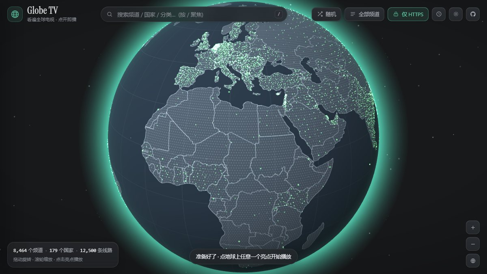
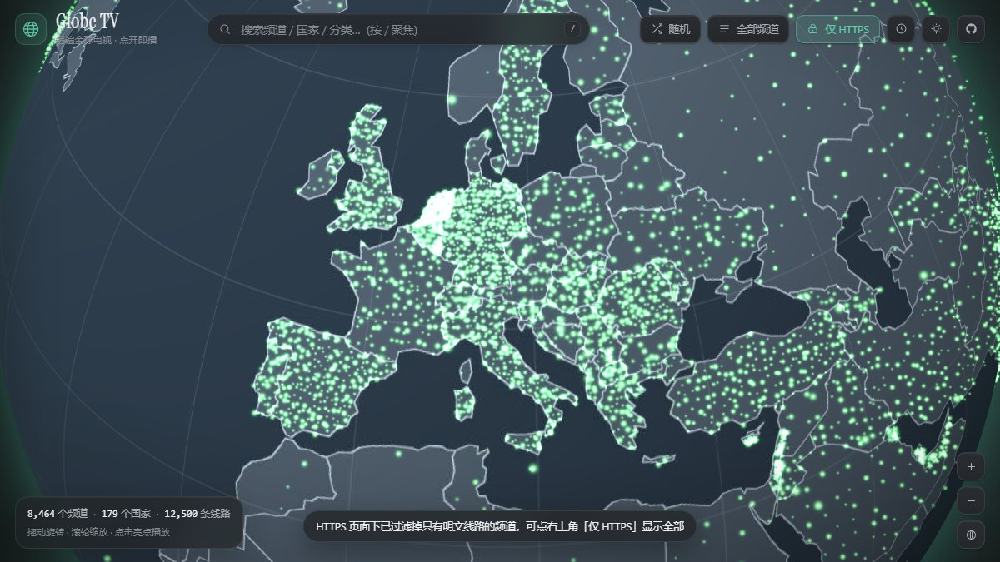
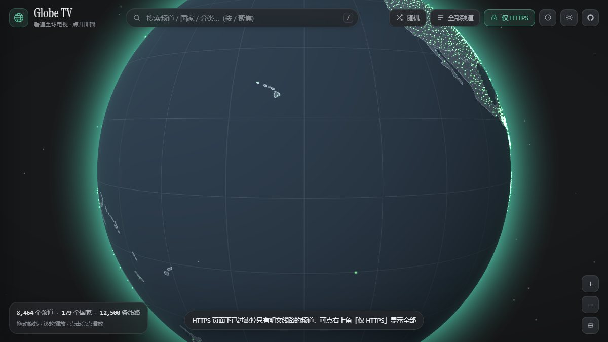
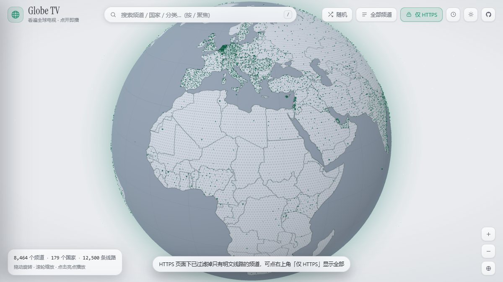
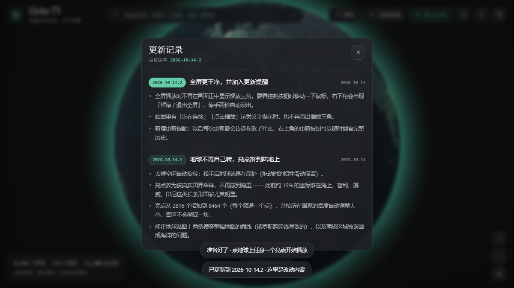

# Globe TV · 看遍全球电视

把全世界的电视频道铺在一颗可以转动的 3D 地球仪上 —— 每个亮点都是一个真实频道，点开就能看。

[](LICENSE)
[](#数据规模)
[](#技术栈)

**在线体验 → <https://global-tv-globe.app.workbuddy.host/>**



## 这是什么

一个纯静态网站。地球上的每一条亮点对应一个真实存在的电视频道，数据来自
[iptv-org](https://github.com/iptv-org/iptv) 的公共 API。

拖动可以旋转地球、滚轮缩放；鼠标悬停在亮点上会显示台标、频道名、国家、清晰度和线路数；
点一下就打开播放器，同时地球会转到那个频道所在的位置。

不需要安装任何东西、不需要 npm install、没有构建步骤 —— 克隆下来起个静态服务就能跑。

## 数据规模

| 项目 | 数量 |
| --- | --- |
| 频道 | **10,102** |
| 国家 / 地区 | **179** |
| 可用线路 | **14,626** |
| 地球上可点的亮点 | **8,464**（HTTPS 下）/ 10,102（关闭筛选后） |
| 频道分类 | 29 |

数据快照：`2026-10-14`。可以随时用 `globetv-dev/build_data.py` 重新拉取最新数据。

## 功能

- **地球仪**：three.js 手写渲染。真实经纬投影、拖动旋转（带惯性）、滚轮 / 双指缩放、双击回正。
  不做空闲自转 —— 手停下来地球就停住。
- **亮点即频道**：悬停出信息卡，点击开播并把地球转到该频道位置。
- **每个频道一个亮点**：总计上万。点的大小随所在国家的密度自动收缩，所以印度（716 个点）
  会形成一片发光区域，而小国是清晰的单个点，密区不会糊成一块。
- **亮点落在真实国土上**：按国界多边形采样（见 [docs/DEVELOPMENT.md](docs/DEVELOPMENT.md#亮点落点必须用真实国界采样)），
  不会撒到海里。
- **播放器**：HLS（hls.js）+ 直链播放。多线路自动择优排序，某条连不上会自动换下一条；
  全部失败会明确区分是「跨域被拒 / 需要 Referer / 源已失效」，并给出复制地址、VLC 打开、随机换一个的出路。
- **全屏是干净的**：全屏播放时画面正中不显示任何按钮（点画面任意位置即可暂停 / 继续）；
  要操作时移动一下鼠标，右下角淡入「暂停 / 退出全屏」，停手 2.6 秒自动淡出。
- **浏览与搜索**：抽屉里有「国家 / 分类 / 收藏」三个视图；顶部搜索支持全库 10,102 个频道即时匹配
  （按 `/` 聚焦）；收藏保存在本地。
- **深色 / 浅色双主题**：两套地球贴图分别渲染，浅色主题下亮点自动切换成深绿实心点
  （加法混合在浅底上会看不见）。
- **HTTPS 适配**：页面跑在 HTTPS 上时，浏览器会拦掉明文 `http://` 流，
  站点会自动只显示「至少有一条 HTTPS 线路」的频道（10,102 → 8,464），
  右上角有开关可以取消筛选。
- **移动端**：响应式布局，触屏拖拽 + 双指缩放；触屏的亮点命中半径放宽到 30.8px
  （鼠标是 19.5px），手指点偏一点也能选中。
- **更新提醒**：每次发版会在右上角按钮点一个小圆点并弹出更新说明，写清这次改了什么。

<details>
<summary>更多截图</summary>

亮点密区（欧洲）与「亮点只落在陆地上」（太平洋半球看不到任何亮点）：




浅色主题、更新提醒、全屏控制条：





</details>

## 快速开始

### 本地跑起来

```bash
# 纯静态，任意静态服务器都行
cd global-tv
python -m http.server 8777
# 打开 http://127.0.0.1:8777/
```

直接双击 `global-tv/index.html` 也能用（会自动退回未压缩的数据文件），
但强烈建议起一个本地服务 —— `file://` 下流媒体的限制更多。

### 部署

把 `global-tv/` 整个目录丢到任意静态托管即可（GitHub Pages、Vercel、Netlify、对象存储…），
不需要后端和数据库。注意用 **HTTPS** 部署时，明文 `http://` 线路会被浏览器拦掉，
站点会自动帮你过滤掉那些频道。

### 更新频道数据

`iptv-org` 每天更新。想拿最新数据：

```bash
cd globetv-dev
python build_data.py     # 需要 Pillow；产出数据 + 两张地球贴图
python bundle.py         # 改过 global-tv/assets/js/*.js 后必须重跑
python build_single.py   # 可选：把整站压成一个 index.html（发布通道只收入口 HTML 时用）
```

## 目录结构

```
.
├── global-tv/            ← 可部署的网站（部署时上传的就是它）
│   ├── index.html
│   └── assets/{css,js,img,fonts,vendor}
├── globetv-dev/          ← 构建与测试脚本（不部署）
│   ├── build_data.py     拉取数据 + 绘制地球贴图（--texture-only 只重做底图）
│   ├── build_single.py   把整站压成单文件 index.html（应急发布用）
│   ├── bundle.py         把 4 个 JS 源文件合并成 app.bundle.js
│   ├── serve_https.py    本地 HTTPS 服务（自签证书，自动生成）
│   └── verify_*.js       端到端测试（真实浏览器驱动）
├── docs/
│   ├── DEVELOPMENT.md   开发与维护手册（构建、测试、发版、踩过的坑）
│   └── images/          README 配图
├── LICENSE
└── .gitignore
```

## 技术栈

| 层 | 用了什么 |
| --- | --- |
| 3D 渲染 | three.js r150，手写 GLSL（球面着色、点精灵亮点、大气辉光、星点） |
| 视频播放 | hls.js 1.5.17（按需加载）+ 原生 `<video>` |
| 前端 | 无框架、无构建产物依赖，原生语法，4 个源文件由脚本合并成 1 个请求 |
| 数据 | iptv-org 公共 API + world-atlas 国界拓扑（Natural Earth：贴图 50m、落点采样 110m） |
| 构建 / 测试 | Python（Pillow 绘贴图）+ Node（CDP 驱动真实浏览器做端到端验收） |

**运行时零依赖**：网站是纯静态文件，不需要 npm、不需要打包器、不需要服务端。

## 已知限制

这些都是浏览器沙箱的硬约束，不是 bug：

1. **跨域被拒的线路**：iptv-org 里相当一部分源站没有配 CORS 许可头，浏览器一律拒绝 ——
   这跟播放器写得好不好无关。实测抽测约 5/6 的线路能拿到播放列表。
2. **要求特定 Referer / User-Agent 的源**：网页里这两个请求头由浏览器管理，JS 改不了，
   这类线路在网页内必然失败。
3. **HTTPS 页面加载 `http://` 流**：会被按混合内容拦掉（1,638 个频道的全部线路都属于这种）。
4. **区域限制**：部分线路只对特定国家开放。
5. **台标**：来自 iptv-org 的 `logos.json`（多为 imgur 外链），加载失败会自动降级成首字母方块。

遇到 1~4 类情况时，播放器会明确告诉你原因，并提供「复制地址」—— 丢进 VLC / mpv 通常就能看。

## 免责声明

- 本项目**只做数据的聚合与呈现**，不存储、不转发、不提供任何流媒体内容。
- 所有频道信息与流地址均来自 [iptv-org](https://github.com/iptv-org/iptv) 的公开数据，
  本项目不对其可用性、合法性作任何保证。
- 频道内容的版权归各自所有者。本项目仅供技术学习与个人测试使用，
  请勿用于任何商业用途，也请遵守你所在地区的法律法规。
- 若你是某个频道的权利方并希望将其从数据源中移除，请向
  [iptv-org](https://github.com/iptv-org/iptv/issues) 提出，本项目的所有渠道数据都来自那里。

## 数据来源与致谢

- 频道 / 线路 / 分类 / 台标 —— [iptv-org](https://github.com/iptv-org/iptv)
- 国别经纬度 —— [world-countries](https://www.npmjs.com/package/world-countries)
- 世界地图轮廓 —— [world-atlas](https://www.npmjs.com/package/world-atlas)（Natural Earth；贴图用 50m，落点采样用 110m）
- 视觉语言参考 —— [radiocast.co](https://www.radiocast.co/)
- 字体 —— Instrument Serif

## License

[MIT](LICENSE)
